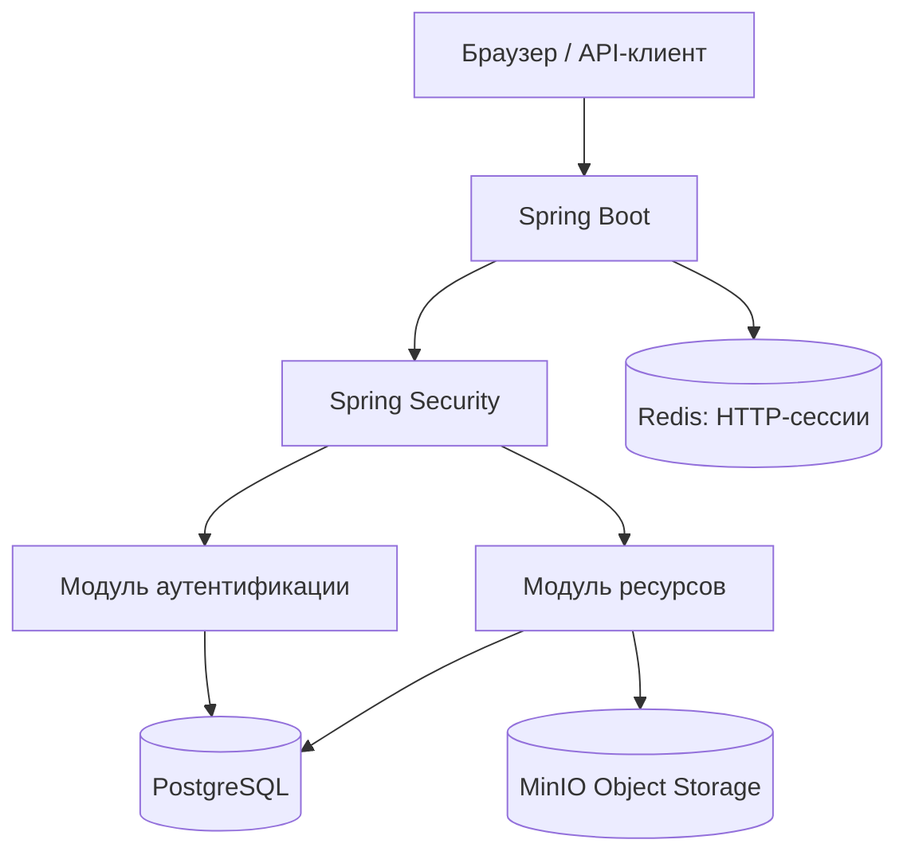

# ☁️ Cloud Storage

**Cloud Storage** — веб-приложение для хранения и управления файлами. Пользователи могут регистрироваться, входить в систему, создавать папки, загружать и скачивать файлы, искать ресурсы, перемещать и удалять их.

Файлы хранятся в **MinIO**, а информация о пользователях и файловых ресурсах — в **PostgreSQL**. Для HTTP-сессий используется **Redis**.

> В репозитории есть `docker-compose.yaml` для запуска PostgreSQL, Redis и MinIO. Сам Spring Boot backend запускается отдельно на локальной машине.

---

## 📌 Содержание

- [Возможности](#-возможности)
- [Технологический стек](#-технологический-стек)
- [Архитектура](#-архитектура)
- [Как устроено хранение](#-как-устроено-хранение)
- [Требования](#-требования)
- [Настройка окружения](#-настройка-окружения)
- [Запуск](#-запуск)
- [Тестирование](#-тестирование)
- [API](#-api)
- [Форматы ответов](#-форматы-ответов)
- [Структура проекта](#-структура-проекта)
- [Безопасность](#-безопасность)
- [Идеи для развития](#-идеи-для-развития)

---

## ✨ Возможности

### Пользовательский аккаунт
- Регистрация с уникальным логином.
- Авторизация и завершение сессии.
- Получение информации о текущем пользователе.
- Пароли хранятся в виде BCrypt-хэшей.
- Доступ к основным API-операциям ограничен авторизованными пользователями.

### Работа с файлами и папками
- Загрузка одного или нескольких файлов.
- Создание папок.
- Получение содержимого папки.
- Получение информации о файле или папке.
- Поиск ресурсов по имени.
- Скачивание файлов.
- Скачивание папок в виде ZIP-архива.
- Удаление файлов и папок.
- Перемещение ресурсов.
- Автоматическое создание вложенных папок при загрузке файла по вложенному пути (если соответствующие промежуточные каталоги отсутствуют).

### Веб-интерфейс
В репозитории находится собранный frontend, размещённый в `src/main/resources/static`. Приложение отдаёт статические файлы интерфейса вместе с backend.

---

## 🧰 Технологический стек

| Технология | Назначение |
|---|---|
| Java 17 | Язык и runtime |
| Spring Boot 4.1.2 | Основа backend-приложения |
| Spring Web MVC | REST API и HTTP-обработка |
| Spring Security | Аутентификация и защита endpoint-ов |
| Spring Data JPA / Hibernate | Работа с базой данных |
| PostgreSQL | Хранение аккаунтов и метаданных ресурсов |
| Flyway | Версионирование и применение миграций БД |
| Redis | Хранение HTTP-сессий |
| MinIO | S3-совместимое объектное хранилище |
| MapStruct | Маппинг сущностей в DTO |
| SpringDoc OpenAPI | Документация API и Swagger UI |
| Gradle | Сборка проекта |
| JUnit 5 | Тестирование |
| Testcontainers | Поднятие PostgreSQL в тестах через контейнеры |

---

## 🏗 Архитектура

Приложение разделено на несколько функциональных областей:



### Основные модули

- **`auth`** — регистрация, вход, выход, получение текущего пользователя и работа с пользовательскими данными.
- **`resources`** — операции с файлами и каталогами, DTO, преобразование путей, бизнес-логика и репозитории метаданных.
- **`storage`** — взаимодействие с MinIO: создание объектов, чтение, получение статистики, перечисление и удаление объектов, копирование.
- **`security`** — конфигурация Spring Security, загрузка пользователя и BCrypt-кодирование паролей.
- **`common`** — общие контроллеры, DTO ошибок и обработчики исключений.

---

## 🗂 Как устроено хранение

Для каждого пользователя используется отдельный префикс в объектном хранилище, основанный на его UUID.

Пример структуры объектов в MinIO:

```text
cloud-storage/
└── <user-uuid>/
    ├── documents/
    │   ├── report.pdf
    │   └── notes.txt
    └── images/
        └── photo.png
```

В MinIO содержится фактическое содержимое файлов. PostgreSQL хранит метаданные, в частности:
- UUID пользователя;
- имя пользователя и пароль;
- путь ресурса;
- имя;
- размер (для файлов);
- тип ресурса (`FILE` или `DIRECTORY`).

### База данных

Миграции Flyway располагаются в `src/main/resources/db/migration`:

| Миграция | Содержание |
|---|---|
| `V1__create_users.sql` | Таблица пользователей |
| `V2__add_enumtype.sql` | Создание типа ресурса |
| `V3__create_resources.sql` | Таблица метаданных ресурсов |
| `V4__change_enum_to_char.sql` | Изменение хранения типа ресурса на строку |

При запуске приложения Flyway применяет миграции автоматически. Hibernate настроен на проверку схемы (`ddl-auto: validate`), а не на её автоматическое создание.

---

## 📋 Требования

Для локального запуска потребуется:

- Java 17 или совместимая JDK.
- PostgreSQL.
- Redis.
- MinIO.
- Git (для клонирования репозитория).

> PostgreSQL, Redis и MinIO должны быть доступны по адресам, указанным в настройках приложения. В корне проекта находится `docker-compose.yaml`, который запускает PostgreSQL, Redis и MinIO.

---

## ⚙️ Настройка окружения

В корне проекта расположен `docker-compose.yaml`. Compose поднимает три инфраструктурных сервиса: PostgreSQL, Redis и MinIO. Docker Compose автоматически читает файл `.env` из корня проекта.

Создайте `.env` в корне по примеру (значения замените своими):

```dotenv
DB_NAME=cloud_storage
DB_USER=cloud_storage_user
DB_PASSWORD=change_me
DB_URL=jdbc:postgresql://localhost:5555/cloud_storage
MINIO_ROOT_USER=minio_admin
MINIO_ROOT_PASSWORD=change_this_password
```

> `DB_URL` должен соответствовать опубликованному Compose-порту PostgreSQL: `5555` на хосте перенаправляется в `5432` контейнера. Имя БД в URL должно совпадать с `DB_NAME`.

### 1. PostgreSQL

Compose использует образ `postgres:16`, создаёт базу и пользователя из `.env`, сохраняет данные в volume `volume-db` и публикует порт `5555` на хосте. Backend, запущенный локально, подключается к `localhost:5555`.

### 2. Redis

Compose запускает Redis и публикует порт `6379`. В `application.yaml` хост Redis указан как `localhost`, порт — `6379`. Redis используется для Spring Session. Время жизни сессии — **5 минут**.

### 3. MinIO

Compose запускает MinIO, публикует API на `9000` и веб-консоль на `9001`, а данные сохраняет в volume `minio-volume`. Credentials задаются переменными `MINIO_ROOT_USER` и `MINIO_ROOT_PASSWORD` из `.env`.

Backend, запущенный локально, обращается к MinIO по `http://localhost:9000`. В `src/main/resources/minio.properties` параметры доступа должны совпадать со значениями `MINIO_ROOT_USER` и `MINIO_ROOT_PASSWORD`. Например:

```properties
minio.url = http://localhost:9000
minio.access = minio_admin
minio.secret = change_this_password
```

При старте приложения проверяется наличие bucket `cloud-storage`; если его нет, приложение создаёт его. Консоль MinIO: `http://localhost:9001`.

### 4. Переменные окружения

Создайте `.env` в корне для Docker Compose. При запуске backend из терминала экспортируйте переменные окружения (или настройте их в IDE), поскольку Spring Boot не загружает `.env` автоматически.

**Не коммитьте `.env`, реальные пароли, access keys или другие секреты.** Если секреты уже попадали в репозиторий, их необходимо заменить (rotate), а не просто удалить из файла.

---

## 🚀 Запуск

### 1. Клонирование репозитория

```bash
git clone https://github.com/Sanechkaprog/files-cloud-storage.git
cd files-cloud-storage
```

### 2. Запуск инфраструктуры

Запустите PostgreSQL, Redis и MinIO. Создайте базу данных PostgreSQL и настройте доступы. Убедитесь, что сервисы доступны на адресах, указанных в `application.yaml` и `minio.properties`.

### 3. Настройка

Перед запуском:
1. Передайте `DB_URL`, `DB_USER`, `DB_PASSWORD` в окружение.
2. Настройте `src/main/resources/minio.properties`.
3. Проверьте адрес Redis в `application.yaml`.
4. Убедитесь, что MinIO доступен и credentials корректны.

### 4. Запуск приложения

Linux / macOS:

```bash
./gradlew bootRun
```

Windows:

```bat
gradlew.bat bootRun
```

При запуске приложение:
- подключается к PostgreSQL;
- выполняет миграции Flyway;
- подключается к Redis для сессий;
- подключается к MinIO;
- проверяет наличие bucket `cloud-storage` и создаёт его при необходимости;
- запускает web-приложение.

Порт приложения не переопределён в `application.yaml`, поэтому используется стандартный порт Spring Boot — **8080**.

Откройте в браузере:

```text
http://localhost:8080/
```

### Сборка JAR

```bash
./gradlew clean build
```

Результат сборки будет в каталоге `build/libs/`.

Запуск собранного приложения:

```bash
java -jar build/libs/files-cloud-storage-0.0.1-SNAPSHOT.jar
```

(Название JAR может отличаться в зависимости от конфигурации сборки.)

---

## 🧪 Тестирование

Запуск тестов:

```bash
./gradlew test
```

В проекте используются JUnit и Testcontainers. Тестовая конфигурация запускает PostgreSQL-контейнер, поэтому для соответствующих тестов необходим работающий Docker.

Покрываемые сценарии, присутствующие в тестах:
- регистрация пользователя;
- регистрация с уже занятым username;
- успешная авторизация;
- авторизация с неверным паролем;
- загрузка Spring-контекста.

---

## 🔌 API

Базовый префикс API: `/api`.

Для большинства endpoint-ов, кроме регистрации и входа, необходима авторизованная сессия. Авторизация основана на HTTP-сессии; браузер должен сохранять и отправлять cookie `JSESSIONID`.

### Аутентификация — `/api/auth`

| Метод | Endpoint | Описание | Успешный ответ |
|---|---|---|---|
| `POST` | `/api/auth/sign-up` | Регистрация | `201 Created` |
| `POST` | `/api/auth/sign-in` | Вход | `200 OK` |
| `POST` | `/api/auth/sign-out` | Выход | `204 No Content` |

#### Регистрация

```http
POST /api/auth/sign-up
Content-Type: application/json
```

```json
{
  "username": "example_user",
  "password": "example_password"
}
```

Успешный ответ:

```json
{
  "username": "example_user"
}
```

#### Вход

```http
POST /api/auth/sign-in
Content-Type: application/json
```

```json
{
  "username": "example_user",
  "password": "example_password"
}
```

При успешном входе сервер создаёт/использует HTTP-сессию и возвращает cookie сессии. Сохраняйте cookie для следующих запросов.

#### Выход

```http
POST /api/auth/sign-out
```

Запрос завершает сессию и очищает cookie `JSESSIONID`.

### Пользователь — `/api/user`

| Метод | Endpoint | Описание |
|---|---|---|
| `GET` | `/api/user/me` | Получить username текущего пользователя |

Пример:

```http
GET /api/user/me
```

Ответ:

```json
{
  "username": "example_user"
}
```

### Файлы и ресурсы — `/api/resource`

| Метод | Endpoint | Описание | Параметры |
|---|---|---|---|
| `POST` | `/api/resource` | Загрузка файлов | `path`, `object` |
| `GET` | `/api/resource` | Получить информацию о ресурсе | `path` |
| `GET` | `/api/resource/search` | Поиск по имени | `query` |
| `GET` | `/api/resource/download` | Скачать файл или папку ZIP | `path` |
| `DELETE` | `/api/resource` | Удалить файл или папку | `path` |
| `POST` | `/api/resource/move` | Переместить ресурс | `from`, `to` |

#### Загрузка файлов

Используется `multipart/form-data`. Поле `path` задаёт каталог назначения, поле `object` — файл(ы); параметр `object` поддерживает несколько файлов.

```bash
curl -X POST "http://localhost:8080/api/resource?path=documents/" \
  -H "Cookie: JSESSIONID=<session-cookie>" \
  -F "object=@./report.pdf" \
  -F "object=@./notes.txt"
```

В примере `path` — относительный путь внутри хранилища пользователя. Каталог назначения должен существовать (вложенные каталоги для пути файла могут быть созданы автоматически логикой сервиса).

#### Получение информации о ресурсе

```bash
curl "http://localhost:8080/api/resource?path=documents/report.pdf" \
  -H "Cookie: JSESSIONID=<session-cookie>"
```

Ответ для файла:

```json
{
  "path": "documents/",
  "name": "report.pdf",
  "size": 12345,
  "type": "FILE"
}
```

Ответ для каталога:

```json
{
  "path": "documents/",
  "name": "reports",
  "type": "DIRECTORY"
}
```

Поля могут отличаться в зависимости от типа ресурса.

#### Получение содержимого папки

```bash
curl "http://localhost:8080/api/directory?path=documents/" \
  -H "Cookie: JSESSIONID=<session-cookie>"
```

Endpoint возвращает список файлов и каталогов в указанной папке.

#### Поиск

```bash
curl "http://localhost:8080/api/resource/search?query=report" \
  -H "Cookie: JSESSIONID=<session-cookie>"
```

Поиск выполняется по имени ресурса, содержащему переданную строку.

#### Скачивание

Файл:

```bash
curl -L "http://localhost:8080/api/resource/download?path=documents/report.pdf" \
  -H "Cookie: JSESSIONID=<session-cookie>" \
  -o report.pdf
```

Каталог скачивается в виде ZIP-архива:

```bash
curl -L "http://localhost:8080/api/resource/download?path=documents/reports/" \
  -H "Cookie: JSESSIONID=<session-cookie>" \
  -o reports.zip
```

#### Удаление

```bash
curl -X DELETE "http://localhost:8080/api/resource?path=documents/report.pdf" \
  -H "Cookie: JSESSIONID=<session-cookie>"
```

Удаление папки приводит к удалению её объектов и метаданных.

#### Перемещение

```bash
curl -X POST "http://localhost:8080/api/resource/move?from=documents/report.pdf&to=archive/report.pdf" \
  -H "Cookie: JSESSIONID=<session-cookie>"
```

Параметры `from` и `to` задают исходный и целевой пути.

### Каталоги — `/api/directory`

| Метод | Endpoint | Описание | Параметры |
|---|---|---|---|
| `POST` | `/api/directory` | Создать папку | `path` |
| `GET` | `/api/directory` | Получить содержимое папки | `path` |

Создание каталога:

```bash
curl -X POST "http://localhost:8080/api/directory?path=documents/new-folder/" \
  -H "Cookie: JSESSIONID=<session-cookie>"
```

Получение списка:

```bash
curl "http://localhost:8080/api/directory?path=documents/" \
  -H "Cookie: JSESSIONID=<session-cookie>"
```

---

## 📖 Swagger / OpenAPI

Документация API генерируется SpringDoc.

После запуска приложения:

- Swagger UI: `http://localhost:8080/swagger-ui.html`
- OpenAPI JSON: `http://localhost:8080/v3/api-docs`

Swagger UI позволяет просматривать endpoint-ы, параметры, модели и ответы.

---

## 📦 Форматы ответов

### DTO ресурса

Файл:

```json
{
  "path": "folder/",
  "name": "file.txt",
  "size": 100,
  "type": "FILE"
}
```

Каталог:

```json
{
  "path": "folder/",
  "name": "subfolder",
  "type": "DIRECTORY"
}
```

Тип ресурса — `FILE` или `DIRECTORY`.

### Ошибки

В приложении предусмотрены обработчики ошибок API. В зависимости от ситуации сервер может возвращать HTTP-коды, например:

| Код | Возможная причина |
|---|---|
| `400 Bad Request` | Некорректные параметры или данные |
| `401 Unauthorized` | Пользователь не авторизован |
| `404 Not Found` | Ресурс или каталог не найден |
| `409 Conflict` | Имя пользователя или ресурс уже существует |
| `500 Internal Server Error` | Внутренняя ошибка сервера или инфраструктуры |

Точный текст ошибки зависит от конкретного обработчика и сценария.

---

## 📁 Структура проекта

```text
files-cloud-storage/
├── gradle/                          # Gradle Wrapper
├── src/
│   ├── main/
│   │   ├── java/com/alexkrug/files_cloud_storage/
│   │   │   ├── auth/                # Регистрация, вход, пользователь
│   │   │   ├── common/              # Общие контроллеры и обработчики
│   │   │   ├── resources/            # Файлы, каталоги, DTO, бизнес-логика
│   │   │   ├── security/             # Spring Security
│   │   │   └── storage/              # Интеграция с MinIO
│   │   │
│   │   └── resources/
│   │       ├── db/migration/         # Миграции Flyway
│   │       ├── static/               # Собранный frontend
│   │       ├── application.yaml      # Настройки Spring
│   │       └── minio.properties      # Настройки MinIO
│   │
│   └── test/
│       └── java/                     # Тесты и Testcontainers
├── build.gradle                      # Зависимости и задачи Gradle
├── settings.gradle
├── gradlew
└── gradlew.bat
```

---

## 🔐 Безопасность

- Для кодирования паролей используется BCrypt.
- Регистрация и вход доступны без авторизации.
- Остальные API-запросы требуют авторизованного пользователя.
- Данные ресурсов привязаны к UUID пользователя при обработке путей.
- Используются сессионная аутентификация и cookie `JSESSIONID`.

**Перед публичным или production-развёртыванием рекомендуется:**
- вынести MinIO credentials из `minio.properties` в переменные окружения/секреты;
- не хранить секреты в Git и заменить credentials, если они были опубликованы;
- настроить HTTPS;
- оценить необходимость CSRF-защиты (в текущей конфигурации CSRF отключён);
- задать ограничения на размер загрузок и проверить настройки reverse proxy;
- настроить резервное копирование PostgreSQL и MinIO;
- настроить мониторинг, логирование и управление доступом к MinIO.

---

## 🛣 Возможные направления развития

Идеи, которые могут расширить текущую функциональность:

- Docker Compose для запуска backend вместе с инфраструктурой одной командой (сейчас Compose поднимает только сервисы инфраструктуры);
- единая конфигурация через environment variables;
- пагинация и сортировка файлов;
- корзина и восстановление удалённых ресурсов;
- публичные ссылки с ограниченным сроком действия;
- квоты на объём хранилища;
- расширенная валидация и ограничения файлов;
- интеграционные тесты API и файловых операций;
- CI pipeline для сборки и тестов;
- поддержка превью изображений и документов.

---

## 👤 Автор / репозиторий

Исходный репозиторий: [Sanechkaprog/files-cloud-storage](https://github.com/Sanechkaprog/files-cloud-storage)

---

<p align="center">
  Сделано для удобного хранения и управления файлами ☁️
</p>
